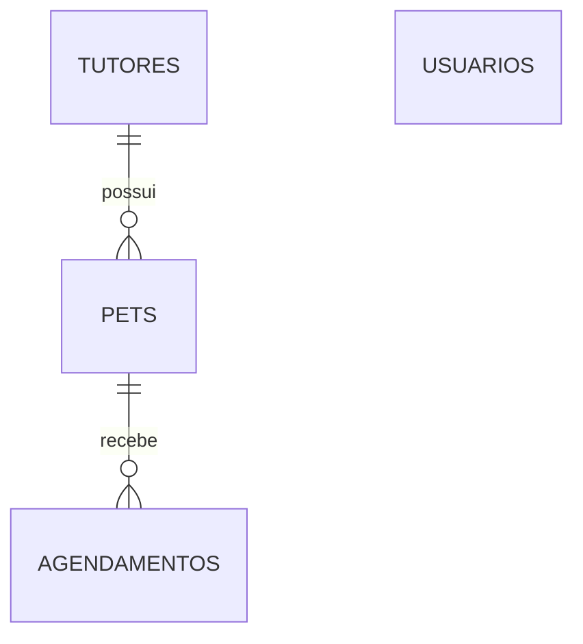

# Clínica Veterinária SAEP — guia completo de reprodução

Este guia ensina como clonar o código, restaurar dependências, compilar, executar e testar a aplicação. A segunda parte mostra como retirar do GitHub arquivos gerados e o banco SQLite versionado.

> **Importante sobre o repositório atual:** além do código, há pastas `bin/`, `obj/` e arquivos SQLite rastreados. O banco versionado contém registros preexistentes. Para repetir o roteiro desde o primeiro acesso, use um arquivo SQLite local novo, conforme a Etapa 2.5.

## Conteúdo

1. [Requisitos](#1-requisitos)
2. [Passo a passo 1 — clonar, compilar, executar e testar](#2-passo-a-passo-1--clonar-compilar-executar-e-testar)
3. [Passo a passo 2 — limpar arquivos do GitHub](#3-passo-a-passo-2--limpar-arquivos-do-github)
4. [Alternativa — usar SQL Server](#4-alternativa--usar-sql-server)
5. [Solução de problemas](#5-solução-de-problemas)
6. [Recursos implementados](#6-recursos-implementados)
7. [Abrir o SQLite no VS Code e gerar o diagrama](#7-abrir-o-sqlite-no-vs-code-e-gerar-o-diagrama)

---

## 1. Requisitos

- Windows 10/11, macOS ou Linux.
- Git instalado.
- [.NET 10 SDK](https://dotnet.microsoft.com/download/dotnet/10.0). É necessário o **SDK**, não somente o runtime.
- Navegador atualizado.
- Internet para baixar os pacotes NuGet na primeira compilação.
- SQL Server acessível, somente se escolher esse provedor em vez de SQLite.

Verifique Git e .NET em um terminal:

```powershell
git --version
dotnet --version
dotnet --list-sdks
```

`dotnet --version` deve mostrar uma versão `10.x`. Se mostrar versão anterior, instale o SDK .NET 10 e abra um terminal novo.

## 2. Passo a passo 1 — clonar, compilar, executar e testar

### 2.1. Clonar o repositório

Abra PowerShell, Windows Terminal ou outro terminal e escolha onde guardar o projeto. Exemplo no Windows:

```powershell
cd $HOME\Documents
git clone https://github.com/ProfCristianoDePaula/Codigo-Exemplo.git
cd Codigo-Exemplo
```

Confira que está na pasta que contém `SAEP-PROVA.csproj`:

```powershell
Get-ChildItem
```

Devem aparecer `SAEP-PROVA.csproj`, `Program.cs` e as pastas `Controllers`, `Models` e `Views`.

### 2.2. Restaurar dependências

Na pasta do `.csproj`, execute:

```powershell
dotnet restore
```

O comando instala localmente as dependências listadas no projeto. Não é necessário instalar pacotes EF Core manualmente.

### 2.3. Compilar

```powershell
dotnet build
```

A execução deve terminar com `Compilação com êxito` (ou `Build succeeded`) e zero erros.

### 2.4. Iniciar a aplicação

Para começar pelo perfil HTTP local:

```powershell
dotnet run --launch-profile http
```

O perfil está configurado em `Properties/launchSettings.json` e usa `http://localhost:5037`.

Para HTTPS:

```powershell
dotnet run --launch-profile https
```

A URL HTTPS configurada é `https://localhost:7170`. Aguarde no terminal a mensagem `Now listening on` / `Agora ouvindo em`; deixe essa janela aberta. Pare o servidor com `Ctrl+C`.

Na inicialização, o EF Core chama `EnsureCreated` e cria tabelas se o banco ainda não tiver schema. Isso não insere registros. Este projeto não usa migrations para inicializar o banco.

### 2.5. Apontar para um banco de teste vazio

O banco `clinica-vet.db` está versionado no repositório e possui registros anteriores, por isso não é o melhor ponto de partida para testar o primeiro acesso. Na pasta do projeto, use um arquivo novo:

```powershell
$env:Database__Provider = "Sqlite"
$env:ConnectionStrings__ClinicaConnection = "Data Source=clinica-vet-teste.db"
dotnet run --launch-profile http
```

O app criará `clinica-vet-teste.db` vazio, com as tabelas necessárias. As variáveis de ambiente ficam ativas somente nessa janela do terminal. Para outro banco de teste, pare a aplicação e mude o nome do arquivo.

Use dados fictícios durante os testes.

### 2.6. Criar a conta inicial

Com o banco novo, acesse `http://localhost:5037`. A aplicação encaminha ao primeiro acesso. Informe nome, e-mail, senha (mínimo de 8 caracteres) e confirmação, e escolha **Criar conta**. A senha é guardada em formato hash; não há senha padrão.

Quando o banco já possui usuários, a configuração do primeiro acesso não aparece. Na tela de login, escolha **Cadastre-se** para criar uma conta adicional. O cadastro é público e o exemplo não separa usuários por nível de permissão.

### 2.7. Testar tutores

1. Abra **Tutores** e selecione **Novo tutor**.
2. Informe nome, e-mail, CPF fictício de teste e telefone; salve.
3. Confira que aparece na listagem. O CPF não é mostrado.
4. Busque por uma parte do nome ou pelo e-mail.
5. Edite o tutor e salve. Para manter o CPF ao editar, deixe o campo CPF vazio.

O CPF é protegido antes de ser persistido no banco.

### 2.8. Testar pets

1. Abra **Pets** > **Novo pet**.
2. Informe nome, espécie e, se desejar, data de nascimento.
3. Selecione o tutor criado anteriormente e salve.
4. Confirme que o nome do tutor aparece junto ao pet e teste a edição.

O vínculo com tutor é obrigatório. Não é possível remover um tutor enquanto houver pets associados.

### 2.9. Testar agendamentos

1. Abra **Agendamentos** > **Novo agendamento**.
2. Informe data/hora e serviço, selecione o pet e salve.
3. Confirme na listagem que aparecem data, serviço, pet e tutor.
4. Confirme que os itens aparecem em ordem cronológica e teste editar a data.

O pet é obrigatório. Não é possível remover um pet que tenha agendamentos.

### 2.10. Testar autenticação e API

- Clique **Sair** e tente abrir **Tutores**; será necessário entrar novamente.
- Faça login com a senha errada e confirme a mensagem de falha. Depois use a senha correta.
- O cookie expira após 30 minutos, sem renovação deslizante.
- Com a sessão autenticada no navegador, abra `http://localhost:5037/api/tutores`. A resposta é JSON e não inclui CPF.
- Para buscar um tutor por identificador, use `http://localhost:5037/api/tutores/1`.

A API compartilha a autenticação por cookie com a interface.

### 2.11. Checklist final

- [ ] `dotnet restore` concluiu.
- [ ] `dotnet build` concluiu sem erros.
- [ ] O servidor iniciou e mostrou uma URL local.
- [ ] Consegui criar uma conta, entrar e sair.
- [ ] Busca e edição de tutor funcionaram.
- [ ] Pet foi salvo com tutor associado.
- [ ] Agendamento foi salvo com pet e tutor exibidos.
- [ ] API retornou JSON sem CPF.

---

## 3. Passo a passo 2 — limpar arquivos do GitHub

Esta limpeza retira da versão atual do repositório as pastas de compilação `bin/`, `obj/` e os arquivos de banco SQLite, e adiciona regras para evitar que sejam enviados outra vez. O envio ao GitHub ocorre somente depois do `git push`.

> Os comandos removem esses arquivos da branch atual após o push, mas não apagam automaticamente cópias presentes em commits antigos. Se o banco tiver dados pessoais, leia [Sobre o histórico antigo](#36-sobre-o-histórico-antigo) antes de publicar.

### 3.1. Clonar e conferir o estado do repositório

Se ainda não tem uma cópia local:

```powershell
cd $HOME\Documents
git clone https://github.com/ProfCristianoDePaula/Codigo-Exemplo.git
cd Codigo-Exemplo
```

Confirme a branch e atualize:

```powershell
git branch --show-current
git remote -v
git status
git switch main
git pull origin main
```

### 3.2. Criar `.gitignore`

Abra um editor de texto, crie um arquivo chamado `.gitignore` na mesma pasta de `SAEP-PROVA.csproj` e cole este conteúdo:

```gitignore
# Saídas de compilação
bin/
obj/
[Bb]uild/
[Dd]ebug/
[Rr]elease/

# Visual Studio e VS Code
.vs/
.vscode/
*.user
*.suo

# Bancos locais SQLite
*.db
*.db-shm
*.db-wal
*.sqlite
*.sqlite3

# Segredos e configurações locais
secrets.json
appsettings.Local.json

# Arquivos temporários do sistema
.DS_Store
Thumbs.db
*.log
```

Salve como `.gitignore` (sem sufixo `.txt`). O `.gitignore` previne rastreamento futuro, mas não desrastreia arquivos que já foram adicionados ao Git.

### 3.3. Parar de rastrear os binários e o banco

No PowerShell, ainda na raiz do repositório, execute:

```powershell
git rm -r --cached -- bin obj
git rm --cached -- clinica-vet.db clinica-vet.db-shm clinica-vet.db-wal
```

A opção `--cached` mantém os arquivos no computador local, mas os prepara para remoção do próximo commit do repositório. Se algum nome não for encontrado, confira os caminhos que o Git realmente rastreia:

```powershell
git ls-files bin obj clinica-vet.db clinica-vet.db-shm clinica-vet.db-wal
```

### 3.4. Revisar antes de publicar

```powershell
git add .gitignore
git status --short
git diff --cached --stat
git diff --cached --name-status
```

Confira que as exclusões são somente arquivos de `bin/`, `obj/` e o banco SQLite; o `.gitignore` deve aparecer como novo. Se algum arquivo de código-fonte estiver marcado para remoção, pare e revise antes do commit.

### 3.5. Commit e push

Quando a lista estiver correta:

```powershell
git commit -m "Remove arquivos gerados e banco local"
git push origin main
```

Atualize a página no GitHub e confirme que `bin/`, `obj/` e `clinica-vet.db*` não aparecem mais na branch principal. Os arquivos locais permanecem por terem sido removidos do índice com `--cached`.

### 3.6. Sobre o histórico antigo

A limpeza acima remove arquivos da versão atual, mas commits antigos podem continuar acessíveis pelo histórico do Git. O banco versionado contém registros de usuário e da aplicação; se forem dados reais, dados pessoais ou segredos, não trate um commit de remoção como apagamento permanente.

A remoção definitiva do histórico exige reescrever commits e fazer um `push --force` ou seguir o procedimento do GitHub para remoção de dados sensíveis. Isso afeta todas as pessoas que clonaram o projeto e pode substituir trabalho remoto. Faça isso somente com backup e coordenação com quem usa o repositório. Troque qualquer senha/segredo que possa ter sido exposto. O procedimento normal acima não usa `push --force`.

### 3.7. Executar depois da limpeza

Na raiz do projeto:

```powershell
dotnet restore
dotnet build
$env:Database__Provider = "Sqlite"
$env:ConnectionStrings__ClinicaConnection = "Data Source=clinica-vet-teste.db"
dotnet run --launch-profile http
```

O arquivo de teste é excluído pelo `.gitignore` e não será enviado ao GitHub por acidente.

---

## 4. Alternativa — usar SQL Server

SQLite é a opção mais simples, pois não requer serviço separado. Para SQL Server, configure User Secrets na pasta do `.csproj`:

```powershell
dotnet user-secrets init
dotnet user-secrets set "Database:Provider" "SqlServer"
dotnet user-secrets set "ConnectionStrings:ClinicaConnection" "Server=NOME_DO_SERVIDOR;Database=ClinicaVet;User Id=USUARIO;Password=SENHA;TrustServerCertificate=True;Encrypt=True"
```

Use os dados fornecidos pelo administrador do servidor. Para SQL Server Express nomeado, o endereço pode se parecer com `Server=localhost\SQLEXPRESS;...`. Se a instância usa porta TCP definida, informe-a, por exemplo `Server=HOST,1433;...`.

Não grave senhas no `appsettings.json`, no README ou no GitHub. O usuário SQL precisa ter permissão para criar as tabelas. Depois execute:

```powershell
dotnet run --launch-profile http
```

Para retornar ao SQLite, defina as variáveis do banco de teste na Etapa 2.5.

## 5. Solução de problemas

### `dotnet` não é reconhecido

Instale o .NET 10 SDK, abra um terminal novo e verifique `dotnet --list-sdks`.

### `NETSDK1045` ou versão-alvo não suportada

O projeto mira `net10.0`; instale o SDK .NET 10. A versão atual aparece com `dotnet --version`.

### Falha no `dotnet restore`

Verifique internet e tente novamente:

```powershell
dotnet restore
```

### Primeiro acesso não aparece

O banco selecionado já tem uma conta. Use um caminho SQLite novo, como descrito na Etapa 2.5. Cada nome novo gera um banco independente.

### Não abre a URL local

Confirme que `dotnet run` continua ativo e use exatamente o endereço exibido por `Now listening on`. Para evitar problema de certificado HTTPS no primeiro uso, tente o perfil HTTP.

### SQL Server não conecta

Confirme serviço ativo, endereço, porta TCP, firewall, usuário, senha, permissões e os valores de User Secrets. Para verificar o restante do app, volte ao SQLite.

### Banco bloqueado ou dados inesperados

Feche outras instâncias do app que usem o mesmo arquivo. Use um arquivo SQLite novo para um cenário de teste limpo.

### Alterei uma model, mas uma tabela antiga não mudou

O código chama `EnsureCreated`: ele cria o schema em banco novo, mas não atualiza schema existente. Para teste, use um arquivo novo. Para evolução de produção, implemente migrations EF Core específicas do provedor e planeje a atualização dos dados.

## 6. Recursos implementados

- ASP.NET Core MVC no .NET 10.
- EF Core com SQLite local por padrão e SQL Server opcional.
- Schema criado no primeiro início, sem inserir seed.
- Primeiro acesso e cadastro de novas contas.
- Senha armazenada com hash; cookie de autenticação com expiração de 30 minutos.
- CRUD de tutores, busca por nome/e-mail e CPF protegido antes de persistir.
- CRUD de pets associados a tutores.
- CRUD de agendamentos associados a pets e ordenados por data.
- API autenticada `GET /api/tutores` e `GET /api/tutores/{id}`, sem CPF na resposta.

> **Nota para produção:** a demonstração permite cadastro público de contas e usa `EnsureCreated`. Antes de publicar para usuários reais, defina a política de cadastro, implemente migrations, configure HTTPS, proteja as chaves de Data Protection e faça backup do banco.


---

## 7. Abrir o SQLite no VS Code e gerar o diagrama

Este roteiro usa a extensão **SQLite DB Explorer**, que abre arquivos `.db` no VS Code e oferece as abas **Data**, **SQL**, **Schema** e **ER Diagram**. O diagrama interativo mostra tabelas e relacionamentos declarados por chaves estrangeiras. Consulte a [página da extensão no Visual Studio Marketplace](https://marketplace.visualstudio.com/items?itemName=sqlite-db-explorer.sqlite-db-explorer).

### 7.1. Criar ou localizar o arquivo do banco

A aplicação não gera o arquivo SQLite até ser executada. Para criar um banco novo e usá-lo para o diagrama, abra um terminal PowerShell na raiz do projeto e rode:

```powershell
$env:Database__Provider = "Sqlite"
$env:ConnectionStrings__ClinicaConnection = "Data Source=clinica-vet-diagrama.db"
dotnet run --launch-profile http
```

Aguarde a mensagem indicando que o servidor iniciou. O arquivo `clinica-vet-diagrama.db` e o schema são criados na pasta de trabalho do projeto durante a inicialização. Não é necessário cadastrar dados para enxergar o diagrama: as tabelas e chaves estrangeiras já bastam.

Quando o terminal mostrar que o app está ouvindo, pressione `Ctrl+C` para encerrar antes de abrir o arquivo. Isso fecha as conexões e evita tentar visualizar o banco enquanto a aplicação está gravando nele.

Se já existe um arquivo `clinica-vet.db` que você quer inspecionar, use esse caminho na etapa 7.3. O banco versionado no repositório pode ter dados antigos. Para visualizar somente o schema com um banco limpo, prefira `clinica-vet-diagrama.db`.

### 7.2. Instalar a extensão no VS Code

1. Abra o Visual Studio Code.
2. Abra a pasta do projeto por **File > Open Folder...** e selecione a pasta onde está `SAEP-PROVA.csproj`.
3. Abra Extensões com `Ctrl+Shift+X` (Windows/Linux) ou `Cmd+Shift+X` (macOS).
4. Pesquise por `SQLite DB Explorer`.
5. Abra a extensão cujo identificador do Marketplace é `sqlite-db-explorer.sqlite-db-explorer` e clique **Install**.
6. Aguarde a instalação terminar.

Opcionalmente, com o comando `code` disponível no terminal, instale via:

```powershell
code --install-extension sqlite-db-explorer.sqlite-db-explorer
```

### 7.3. Abrir o arquivo `.db`

No Explorer do VS Code, encontre `clinica-vet-diagrama.db` e clique duas vezes. Se aparecer uma caixa **Select Editor**, escolha o editor do SQLite DB Explorer. Outra opção é abrir a Paleta de Comandos (`Ctrl+Shift+P`) e executar:

```text
SQLite: Open Database
```

Selecione o arquivo `clinica-vet-diagrama.db` na pasta do projeto. Se a extensão perguntar como abrir o arquivo, escolha SQLite DB Explorer.

O banco será aberto em uma aba própria. As opções oferecidas pela extensão incluem Data, SQL, Schema e ER Diagram.

### 7.4. Exibir o diagrama ER

1. Na aba do banco, clique em **ER Diagram**.
2. Aguarde a extensão ler o schema e posicionar as tabelas.
3. Use zoom, pan ou **fit to view** para centralizar o desenho.
4. Arraste as caixas para organizá-las, se necessário.
5. Verifique que as setas correspondem aos vínculos esperados:
   - `Tutores` para `Pets` (um tutor pode ter vários pets);
   - `Pets` para `Agendamentos` (um pet pode ter vários agendamentos);
   - `Usuarios` não tem relação com as outras três tabelas.

O desenho esperado, em forma simplificada, é:



A extensão detecta relacionamentos gravados como foreign keys. Se as tabelas aparecerem, mas não houver setas, consulte as chaves estrangeiras no editor SQL:

```sql
PRAGMA foreign_key_list('Pets');
PRAGMA foreign_key_list('Agendamentos');
```

Também é possível confirmar que o arquivo tem as quatro tabelas:

```sql
SELECT name
FROM sqlite_master
WHERE type = 'table'
  AND name NOT LIKE 'sqlite_%'
ORDER BY name;
```

### 7.5. Salvar uma imagem do diagrama

A aba ER Diagram apresenta uma visualização interativa. A listagem da extensão documenta navegação e zoom, mas não promete exportação direta do diagrama como imagem. Para anexar uma imagem a uma atividade:

1. Ajuste o zoom para que todas as tabelas e setas fiquem visíveis.
2. Use a captura de tela do sistema operacional (`Win+Shift+S` no Windows).
3. Salve a captura como `der.png` na pasta desejada.
4. Confira que nomes das tabelas, PKs, FKs e relacionamentos estão legíveis.

Se precisar exportar diretamente para SVG/PNG, uma alternativa é a extensão [ERD Renderer & Database Visualizer](https://marketplace.visualstudio.com/items?itemName=shubhamshakya.erd-renderer), que lista conexão a banco SQLite e exportação de imagem. Revise as permissões e o fluxo de conexão da extensão antes de usá-la.

### 7.6. Cuidados com o arquivo

SQLite DB Explorer também oferece recursos para editar dados e schema. Para este roteiro, use somente as abas **Schema** e **ER Diagram**. Não clique em editar, adicionar ou excluir linhas/tabelas. Se for explorar essas funções, faça uma cópia do `.db` primeiro.

Arquivos `.db`, `.db-shm` e `.db-wal` são arquivos locais de dados; mantenha-os fora do GitHub com as regras do `.gitignore` da Etapa 3.2. Não suba dados de pessoas reais para o repositório.
